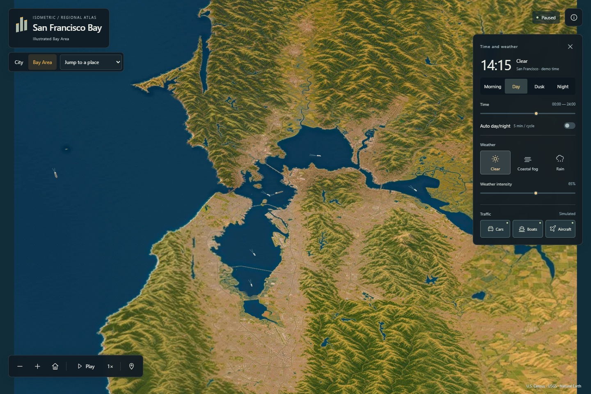

# Isometric San Francisco

A living illustrated map of the San Francisco Bay Area. Explore the Pacific coast, North Bay and Delta, East Bay, Peninsula and South Bay, with street-level detail in San Francisco and the inner Bay. Inspired by [Isometric NYC](https://cannoneyed.com/projects/isometric-nyc) and [Isometric Vancouver](https://vancouver.isoworld.xyz/).

**[Explore the live atlas](https://dilee-king.github.io/isometric-san-francisco/?v=0.9.0)** · [Browser recording](docs/Full-Bay-browser-demo.mp4) · [Verification](docs/VERIFICATION-full-bay.md) · [Roadmap](ROADMAP.md)



## Explore

- **Bay Area** opens the continuous illustrated map. Zoom from the Pacific coast to the Delta and from Sonoma and Napa to San Jose. The place menu offers 35 stops, including 16 closer views. The regional plate and the closer tiles share one camera.
- **City** opens the original street-level atlas and its 63 place jumps. Explore from Ocean Beach to Hunters Point, cross both Bay Bridge spans through Yerba Buena Island, and follow the shores to Alameda and Sausalito.
- **Time and weather:** Morning, Day, Dusk and Night; manual time or a five-minute cycle; Clear, Coastal Fog and Rain. Rain changes wet surfaces and reflections in addition to moving drops and impacts.
- **Traffic** independently toggles cars, vessels and aircraft. In the regional view their enlargement tapers as you zoom. Pausing freezes all clocks, including across map-view switches.
- **Navigation:** drag and scroll, or use the map tools. Home returns to the default view; +/− zoom; Space plays or pauses when the map has focus. On mobile, use **Environment** to show the time/weather panel. Reduced motion starts paused. Without WebGL2, projected Canvas transport and dry lighting remain available; the unavailable effects are explained.

The releases are available from the same viewer.

| Version | Coverage | Browser capture |
| --- | --- | --- |
| [v0.6.1](https://dilee-king.github.io/isometric-san-francisco/?v=0.6.1) | Citywide San Francisco, the Bay Bridge and Yerba Buena Island | [Golden Gate Park](docs/screenshots/v0.6.1/golden-gate-park.jpg), [East Span](docs/screenshots/v0.6.1/bay-bridge-east.jpg) |
| [v0.7.1](https://dilee-king.github.io/isometric-san-francisco/?v=0.7.1) | Port of Oakland, Jack London Square and Alameda ferry terminals | [Port of Oakland](docs/screenshots/v0.7.1/oakland-port.jpg), [Jack London Square in rain](docs/screenshots/v0.7.1/jack-london-rain-night.jpg) |
| [v0.8.1](https://dilee-king.github.io/isometric-san-francisco/?v=0.8.1) | Fort Baker, Sausalito and the ferry across the bay | [Fort Baker](docs/screenshots/v0.8.1/fort-baker.jpg), [Bay overview](docs/screenshots/v0.8.1/bay-overview.jpg) |
| [v0.9.0](https://dilee-king.github.io/isometric-san-francisco/?v=0.9.0) | Continuous Bay Area illustration and 16 closer views | [Full Bay](docs/screenshots/v0.9.0/whole-bay.jpg), [SFO in rain](docs/screenshots/v0.9.0/sfo-rain-night.jpg), [Alviso](docs/screenshots/v0.9.0/alviso.jpg) |

## Run locally

Requires Node.js 24+. The map uses bundled assets; runtime does not need a map API key or an external basemap.

```powershell
npm ci
npm run dev
```

Development: `http://127.0.0.1:5186/`. Production preview:

```powershell
npm test
node tools/audit-atlas.mjs
node --experimental-strip-types tools/audit-city-core.mjs
node --experimental-strip-types tools/audit-illustrated-expansion.mjs
node --experimental-strip-types tools/audit-full-bay.mjs
npm run build
npm run preview
```

The production preview runs at `http://127.0.0.1:4186/`. GitHub Actions verifies the source/mask and asset checks and deploys GitHub Pages on updates to `main`.

## How it is made

The inner Bay atlas uses the original 39° orthographic camera and a 55296 × 30720 pixel grid. ImageGen extends the v0.5 illustrations in overlapping passes. A new plate uses the completed neighboring artwork and a registered guide for road crossings, parcels and shorelines. Detail plates use the original 1.854545 pixels per metre at the new location jumps. Wider illustrated plates connect those views, following the v0.5 approach to context. Four appearances combine the selected illustrations, wet-night edits, street lighting and a common offshore water field.

The Bay Area artwork uses 16 overlapping regional plates and 16 closer views. The new plates follow Census TIGER/Line shorelines and main roads, Natural Earth land and urban extents, USGS 3DEP and registered USDA NAIP aerial guides. Each close-up adds up to eight times the regional artwork's pixel density. The retained city artwork uses DataSF footprints, USGS lidar and OpenStreetMap. Both views share an EPSG:32610 origin and camera orientation. [Source credits](ACKNOWLEDGMENTS.md)

The four WebP pyramids use a shared grid and request higher-resolution tiles in the visible region. The regional layer fills the view between closer plates. Vehicle geometry is uploaded once per style, and the render loop updates each vehicle's position and heading. Lights outside the viewport are culled. The west and east Bay Bridge carriageways use a continuous distance measure through the hidden tunnel segments. Ferry and cargo routes use source shoreline clearances.

## Rebuild

Selected artwork and exact ImageGen prompts are in [assets/illustrated-expansion](assets/illustrated-expansion/). The original plates are in [assets/city-core](assets/city-core/), [assets/golden-gate](assets/golden-gate/) and [assets/corridor](assets/corridor/). The [registered data](data/illustrated-expansion/) and [source provenance](data/inner-bay/provenance.json) are checked in. Package the three illustrated releases from the selected plates:

```powershell
python -m pip install -r tools/requirements-corridor.txt
npm run tiles
node --experimental-strip-types tools/audit-illustrated-expansion.mjs
```

Use `python tools/illustrated_guides.py --ids civic-center` to regenerate a registered drawing guide. The tile command places the selected artwork, applies the four appearances and writes the regional packs. Completed blocks are reused when their source and output hashes match. [Explore the original v0.5 viewer](https://dilee-king.github.io/isometric-san-francisco/?v=0.5.0)

Rebuild the Bay Area pack with `npm run tiles:bay`. Use `python tools/bay_illustration_guides.py` for the base guide, `--extend <plate>` to attach adjacent completed art, and `--aerial <detail-plate>` for closer guides. The [selected plates and prompts](assets/full-bay/plates/) and the [tile manifest](public/map/v9-art/bay/manifest.json) record the artwork and input hashes.

## Scope

The Bay Area view uses regional-scale artwork between its named closer views. Street-level coverage follows the San Francisco mainland, nearby islands, the Oakland and Alameda shoreline and the Marin shore to Sausalito. Illustrated edges, façades, traffic, light and weather use approximate registration. [Coverage](data/coverage-plan.json) · [Source credits](ACKNOWLEDGMENTS.md) · [MIT license](LICENSE)
