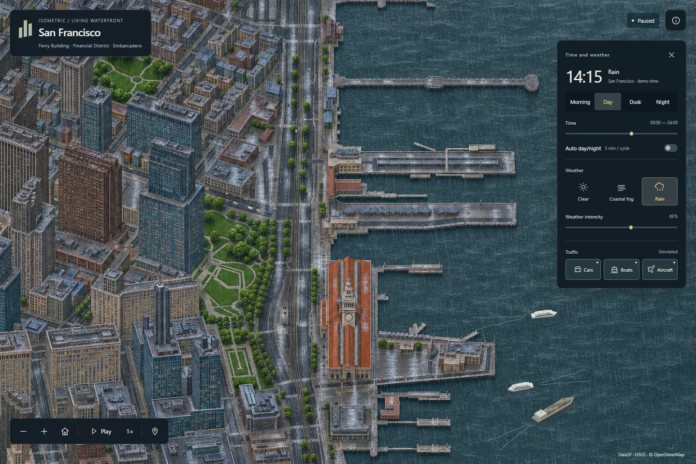

# Isometric San Francisco

A living illustrated waterfront, inspired by [Isometric NYC](https://cannoneyed.com/projects/isometric-nyc) and [Isometric Vancouver](https://vancouver.isoworld.xyz/).

**[Explore the live map](https://dilee-king.github.io/isometric-san-francisco/?v=0.2.0)** · [Actual demo video](docs/Waterfront-actual-demo-v0.2.mp4) · [Verification](docs/VERIFICATION-v0.2.md) · [Roadmap](ROADMAP.md)



The current release is a continuous sample around the Ferry Building, Financial District and Embarcadero. It is not a city-wide map.

## What changed in v0.2

- **Transport perspective:** cars, ferries, the cargo ship and aircraft are built in forward/side/up metres. Every body, cabin, hull, wing and tail vertex uses the map's orthographic camera. World-space widths, height and foreshortening replace rotated top-view icons.
- **A visibly wet city:** Rain switches to separately authored wet daytime/nighttime tiles, with darker roofs, soaked paving, puddles, reflections and rain-disturbed water. Animated streaks, surface impacts and reduced visibility complement those surface changes.
- **Three weather choices:** Clear, Coastal Fog and Rain. The approved dry artwork and fog treatment are retained.
- **English throughout the current experience:** interface, accessibility text, place labels and main documentation. The decorative lower-left caption and sample label have been removed.

## Explore

Drag to pan; scroll or use the map tools to zoom. The right panel controls time, weather and transport. On a phone, open **Environment** to reveal the controls.

- Choose Morning, Day, Dusk or Night, or scrub the time slider.
- Enable **Auto day/night** for an approximately five-minute cycle.
- Select Clear, Coastal Fog or Rain; adjust weather intensity.
- Toggle Cars, Boats and Aircraft independently. Aircraft appear as occasional overflights.
- Pause freezes traffic, time and weather. Map navigation stays available. Hidden tabs suspend all clocks without changing the pause setting.
- Reduced-motion preference starts the scene paused. Without WebGL2, projected Canvas transport and the dry map/night view remain available; unavailable weather effects are explained and disabled.

Keyboard: focus the map, then use Space to play/pause, Home to reset, and + / − to zoom. All controls are keyboard accessible.

## Run locally

Requires Node.js 24+. First-time dependency installation needs a network connection. The running map uses bundled local assets, without a map API key, login or external basemap service.

```powershell
npm ci
npm run dev
```

Open the printed address, normally `http://127.0.0.1:5186/`.

```powershell
npm test
node tools/audit-assets.mjs
npm run build
npm run preview
```

Production preview uses `http://127.0.0.1:4186/`.

## Production method

One fixed orthographic structure reference is built from DataSF footprints, USGS lidar and OpenStreetMap. Original illustrated appearances are prepared and repaired as registered images, then exported as multiresolution WebP/DZI pyramids. React and OpenSeadragon provide continuous navigation. A worker controls transport and independent clocks; projected world-space meshes, source-depth clipping and WebGL atmosphere use one shared transform.

Vancouver's deployed traffic renderer was inspected directly: it constructs vehicle body and cabin corners in world metres, projects them through the city camera, then applies structure masks. This project implements that geometric principle with its own camera and original models. No Vancouver artwork or unverified-license code is copied. See the [reference audit](docs/v0.2-reference-audit.md).

GitHub Actions verifies model/geometry tests, the source-bundle regression and asset hashes, then builds and deploys GitHub Pages when `main` changes. The `map/v2` namespace preserves the prior release assets.

## Rebuild the assets

Selected original PNGs, exact prompts, derived source geometry, camera metadata and masks are included. Built-in imagegen created the artwork; Python performs source rasterization, format conversion and deterministic tile packaging.

```powershell
python -m pip install -r tools/requirements.txt
python tools/test_source_pipeline.py
python tools/package_tiles.py
```

To regenerate the structural reference and canonical source masks, run `python tools/prepare_source.py --source data/source/ferry.json`, then package again. Artwork generation itself is not deterministic; the selected originals and their hashes are retained.

## Scope and limits

The sample contains 72 car instances following 22 source-directed road loops, two ferries, one cargo vessel and an occasional aircraft. Routes, lane offsets, stops, building detail, lighting and weather are illustrative. There is no full signal controller, vehicle-following model, live transport feed, airport operation or physical weather/solar simulation.

The source-input extent is 1200 × 1200 m in EPSG:32610; the illustration is a cropped orthographic view. This input extent is not the finished map's land area. AI drawing can shift local edges; source-depth clipping and final-art alignment are display approximations. The wet-surface mask is an illustrative source-derived display layer, not measured imperviousness.

Original application code and documentation are [MIT licensed](LICENSE). Third-party dependencies and data retain their own notices. DataSF PDDL, USGS public-domain data, and [© OpenStreetMap contributors / ODbL](https://www.openstreetmap.org/copyright) are credited separately. Read [Acknowledgments](ACKNOWLEDGMENTS.md), [asset provenance](assets/README.md) and the [coverage record](data/coverage-plan.json).
