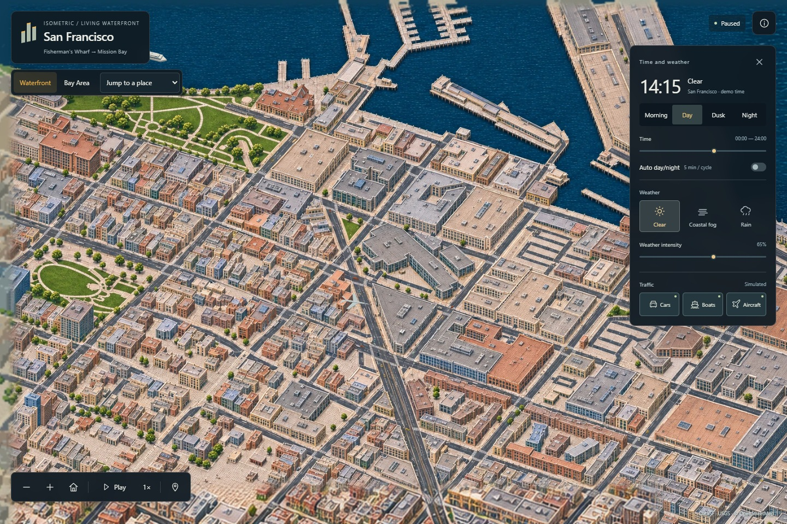

# Isometric San Francisco

A living illustrated map from Fisherman's Wharf to Mission Bay, with a regional Bay Area atlas. Inspired by [Isometric NYC](https://cannoneyed.com/projects/isometric-nyc) and [Isometric Vancouver](https://vancouver.isoworld.xyz/).

**[Explore the live atlas](https://dilee-king.github.io/isometric-san-francisco/?v=0.3.0)** · [Actual demo video](docs/Waterfront-actual-demo-v0.3.mp4) · [Verification](docs/VERIFICATION-v0.3.md) · [Roadmap](ROADMAP.md)



## Explore

- **Waterfront:** pan continuously from Fisherman's Wharf and Pier 39 through the Embarcadero, Ferry Building, Bay Bridge approach, South Beach, Oracle Park and Mission Bay. The location selector has 12 jumps; the whole corridor is one navigable surface.
- **Bay Area:** switch to a regional terrain atlas with coastline, 26 towns/cities, major crossings and SFO, OAK and SJC. The amber outline marks the detailed waterfront. This view is regional context; detailed city coverage remains the published waterfront.
- **Time and weather:** Morning, Day, Dusk and Night; manual time or a five-minute cycle; Clear, Coastal Fog and Rain. Rain changes wet surfaces and reflections in addition to moving drops and impacts.
- **Traffic:** independently show cars, vessels and aircraft. The original world-space projection remains; the regional view enlarges transport for legibility. Pausing freezes all clocks, including across map-view switches.
- **Navigation:** drag and scroll, or use the map tools. Home returns to the default view; +/− zoom; Space plays or pauses when the map has focus. On mobile, use **Environment** to show the time/weather panel. Reduced motion starts paused. Without WebGL2, projected Canvas transport and dry lighting remain available; the unavailable effects are explained.

Actual captures: [Pier 39](docs/screenshots/v0.3/pier-39-clear.jpg) · [Oracle Park in rain](docs/screenshots/v0.3/oracle-rain-night.jpg) · [Mission Bay](docs/screenshots/v0.3/mission-bay-clear.jpg) · [Bay Area](docs/screenshots/v0.3/bay-overview.jpg).

## Run locally

Requires Node.js 24+. The map uses bundled assets; runtime does not need a map API key or an external basemap.

```powershell
npm ci
npm run dev
```

Development: `http://127.0.0.1:5186/`. Production preview:

```powershell
npm test
node tools/audit-atlas.mjs
npm run build
npm run preview
```

The production preview runs at `http://127.0.0.1:4186/`. GitHub Actions verifies the source/mask and asset checks and deploys GitHub Pages on updates to `main`.

## How it is made

The waterfront is a 5372 × 7398 pixel registered atlas. Ten overlapping detailed patches share the original 39° orthographic camera and 1.854545 pixels per metre. The Ferry Building is the retained v0.2 anchor; nine new patches use original built-in imagegen artwork at 1536 × 1024 per appearance. Sixteen lower-density contextual appearances fill their margins. The dry day, dry night, wet day and wet night mosaics are packaged as WebP/DZI pyramids. No detailed patch is enlarged from a smaller generation.

Source structures use [DataSF footprints](https://data.sf.gov/Geographic-Locations-and-Boundaries/Building-Footprints/ynuv-fyni), [USGS 2023 lidar](https://www.fisheries.noaa.gov/inport/item/73386) and [OpenStreetMap](https://www.openstreetmap.org/copyright). The overview uses [Natural Earth](https://www.naturalearthdata.com/) land/urban vectors and [USGS 3DEP elevation](https://elevation.nationalmap.gov/arcgis/rest/services/3DEPElevation/ImageServer), with schematic regional connectors. Both share an EPSG:32610 origin and orientation.

The viewer requests visible tiles at the needed zoom; inactive appearances load on demand. Small registered source masks drive approximate occlusion and atmosphere. React/OpenSeadragon provide the fixed-view map; a worker holds clocks and source-directed transport. The detailed corridor has 360 configured cars, five ferries, two cargo vessels and three occasional overflights. These are simulation instances, not observed traffic counts.

## Rebuild

Selected artwork and exact prompts are in [assets/corridor](assets/corridor/). [Source provenance](data/corridor/provenance.json), the compressed local geometry snapshot and both runtime manifests are checked in. For data acquisition and offline production:

```powershell
python -m pip install -r tools/requirements-corridor.txt
python tools/corridor_inputs.py
python tools/corridor_source.py
python tools/render_corridor.py wharf embarcadero south-beach mission-bay
python tools/corridor_art_targets.py
python tools/package_corridor.py
node tools/audit-atlas.mjs
```

Raw network inputs stay in the ignored local cache; the original source snapshot can be reused without reacquiring it for waterfront reference generation. Selected imagegen results are retained because artwork generation is not deterministic. The package rebuild uses those selected assets, not new generation. The v1/v2 assets remain available as release history.

## Scope

Coverage is the illustrated waterfront corridor plus a lower-detail regional overview, not full city- or nine-county street-level coverage. AI artwork can shift individual edges; lane offsets, facade details, bridge elevation, depth masks, lights and weather remain illustrative. Vehicle/ship routes are source-constrained where noted, without live trip feeds, physical weather, collision simulation or airport operations. See [coverage](data/coverage-plan.json) and [Acknowledgments](ACKNOWLEDGMENTS.md) for boundaries and licenses. Original code and documentation use the [MIT license](LICENSE); third-party data retain their respective notices.
