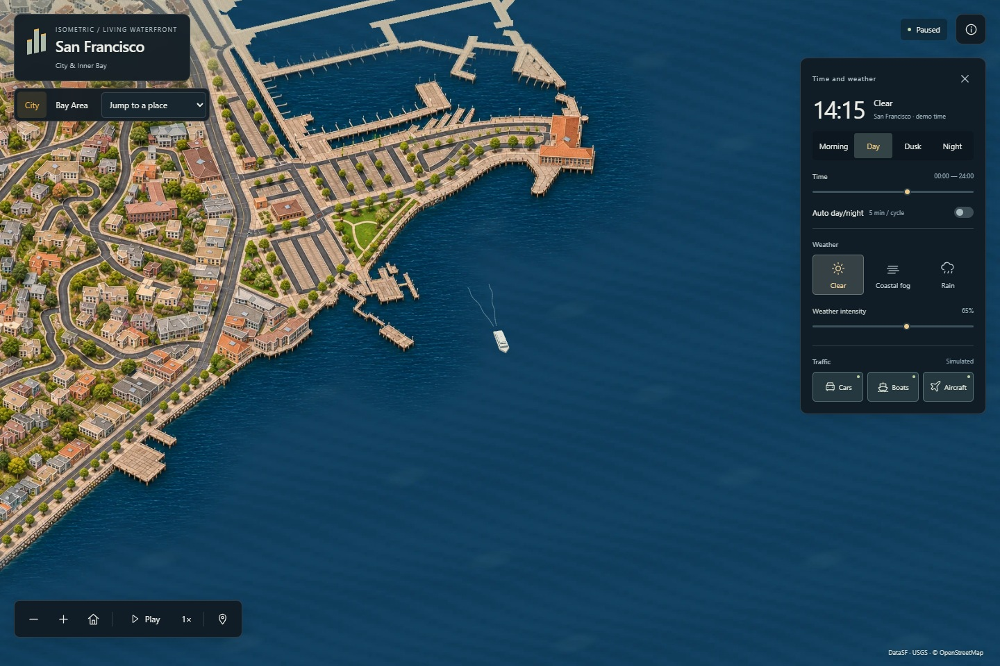

# Isometric San Francisco

A living illustrated map of San Francisco, the Bay Bridge, the Oakland and Alameda waterfront, and the Marin shore to Sausalito. Inspired by [Isometric NYC](https://cannoneyed.com/projects/isometric-nyc) and [Isometric Vancouver](https://vancouver.isoworld.xyz/).

**[Explore the live atlas](https://dilee-king.github.io/isometric-san-francisco/?v=0.8.0)** · [Browser recording](docs/Inner-Bay-actual-demo.mp4) · [Verification](docs/VERIFICATION-v0.6-v0.8.md) · [Roadmap](ROADMAP.md)



## Explore

- **City** opens the detailed view. The latest release includes 63 place jumps across San Francisco and the inner Bay. Explore from Ocean Beach to Hunters Point, cross both Bay Bridge spans through Yerba Buena Island, and follow the shores to Alameda and Sausalito.
- **Bay Area** switches to a regional terrain atlas with coastline, 26 towns/cities, major crossings and SFO, OAK and SJC. The amber outline marks the detailed areas and crossings.
- **Time and weather:** Morning, Day, Dusk and Night; manual time or a five-minute cycle; Clear, Coastal Fog and Rain. Rain changes wet surfaces and reflections in addition to moving drops and impacts.
- **Traffic:** independently show cars, vessels and aircraft. The original world-space projection remains; the regional view enlarges transport for legibility. Pausing freezes all clocks, including across map-view switches.
- **Navigation:** drag and scroll, or use the map tools. Home returns to the default view; +/− zoom; Space plays or pauses when the map has focus. On mobile, use **Environment** to show the time/weather panel. Reduced motion starts paused. Without WebGL2, projected Canvas transport and dry lighting remain available; the unavailable effects are explained.

The releases are available from the same viewer.

| Version | Coverage | Browser capture |
| --- | --- | --- |
| [v0.6](https://dilee-king.github.io/isometric-san-francisco/?v=0.6.0) | Citywide San Francisco, the Bay Bridge and Yerba Buena Island | [Golden Gate Park](docs/screenshots/v0.6/golden-gate-park.jpg), [East Span](docs/screenshots/v0.6/bay-bridge-east.jpg) |
| [v0.7](https://dilee-king.github.io/isometric-san-francisco/?v=0.7.0) | Port of Oakland, Jack London Square and Alameda ferry terminals | [Port of Oakland](docs/screenshots/v0.7/oakland-port.jpg), [Jack London Square in rain](docs/screenshots/v0.7/jack-london-rain-night.jpg) |
| [v0.8](https://dilee-king.github.io/isometric-san-francisco/?v=0.8.0) | Fort Baker, Sausalito and the ferry across the bay | [Fort Baker](docs/screenshots/v0.8/fort-baker.jpg), [Bay overview](docs/screenshots/v0.8/bay-overview.jpg) |

## Run locally

Requires Node.js 24+. The map uses bundled assets; runtime does not need a map API key or an external basemap.

```powershell
npm ci
npm run dev
```

Development: `http://127.0.0.1:5186/`. Production preview:

```powershell
npm test
node tools/audit-atlas.mjs
node --experimental-strip-types tools/audit-city-core.mjs
node --experimental-strip-types tools/audit-inner-bay.mjs
npm run build
npm run preview
```

The production preview runs at `http://127.0.0.1:4186/`. GitHub Actions verifies the source/mask and asset checks and deploys GitHub Pages on updates to `main`.

## How it is made

The inner Bay atlas has one 55296 × 30720 pixel grid with the original 39° orthographic camera and 1.854545 pixels per metre. Citywide streets, roofs and terrain are drawn from source geography. Eleven new 1536 × 1024 artwork plates add detail at selected landmarks, alongside the retained v0.5 corridor artwork. The Bay Bridge decks, towers, cables, approaches and tunnel portals share the traffic coordinates. Four appearances combine authored artwork, registered lighting, wet materials and one offshore water field.

Source structures use [DataSF footprints](https://data.sf.gov/Geographic-Locations-and-Boundaries/Building-Footprints/ynuv-fyni), [USGS 2023 lidar](https://www.fisheries.noaa.gov/inport/item/73386), [USGS 3DEP elevation](https://elevation.nationalmap.gov/arcgis/rest/services/3DEPElevation/ImageServer) and [OpenStreetMap](https://www.openstreetmap.org/copyright). The bridge proportions follow the [district's published dimensions](https://www.goldengate.org/bridge/history-research/statistics-data/design-construction-stats/). The regional view uses [Natural Earth](https://www.naturalearthdata.com/) land/urban vectors, 3DEP terrain and schematic connectors. Both views share an EPSG:32610 origin and orientation.

The four WebP pyramids share a low-zoom backdrop and request native tiles inside active detail blocks. Each release activates its own coverage and route list over the shared assets. Image coordinates, the packed source mask and the simulation worker remain shared across the detailed view. The west and east Bay Bridge carriageways use a continuous distance measure through the hidden tunnel segments. Ferry and cargo routes use source shoreline and bridge-pier clearances.

## Rebuild

Selected artwork and exact prompts are in [assets/inner-bay](assets/inner-bay/), [assets/city-core](assets/city-core/), [assets/golden-gate](assets/golden-gate/) and [assets/corridor](assets/corridor/). The [inner Bay source provenance](data/inner-bay/provenance.json), compressed geometry and runtime manifests are checked in. To package the three releases from retained source and artwork:

```powershell
python -m pip install -r tools/requirements-corridor.txt
npm run tiles
node --experimental-strip-types tools/audit-inner-bay.mjs
```

Raw network inputs stay in the ignored local cache. `python tools/expanded_inputs.py` collects the bounded inputs and `python tools/expanded_source.py` rederives the geographic snapshot. The tile command reuses the checked-in snapshot and selected art. Individual render and package stages accept `--help`, and finished blocks are reused when their source and code hashes match. The [v0.5 viewer](https://dilee-king.github.io/isometric-san-francisco/?v=0.5.0) remains available alongside the expanded releases.

## Scope

Detailed coverage follows the mainland city, nearby islands, the Oakland and Alameda shoreline and the Marin shore to Sausalito. The Bay Area view supplies broader geographic context. AI artwork can shift individual edges. Lane offsets, facade details, bridge elevations, depth masks, lights and weather remain illustrative. Transport follows configured source-directed routes. See [coverage](data/coverage-plan.json) and [Acknowledgments](ACKNOWLEDGMENTS.md) for boundaries and licenses. Original code and documentation use the [MIT license](LICENSE). Third-party data retain their respective notices.
