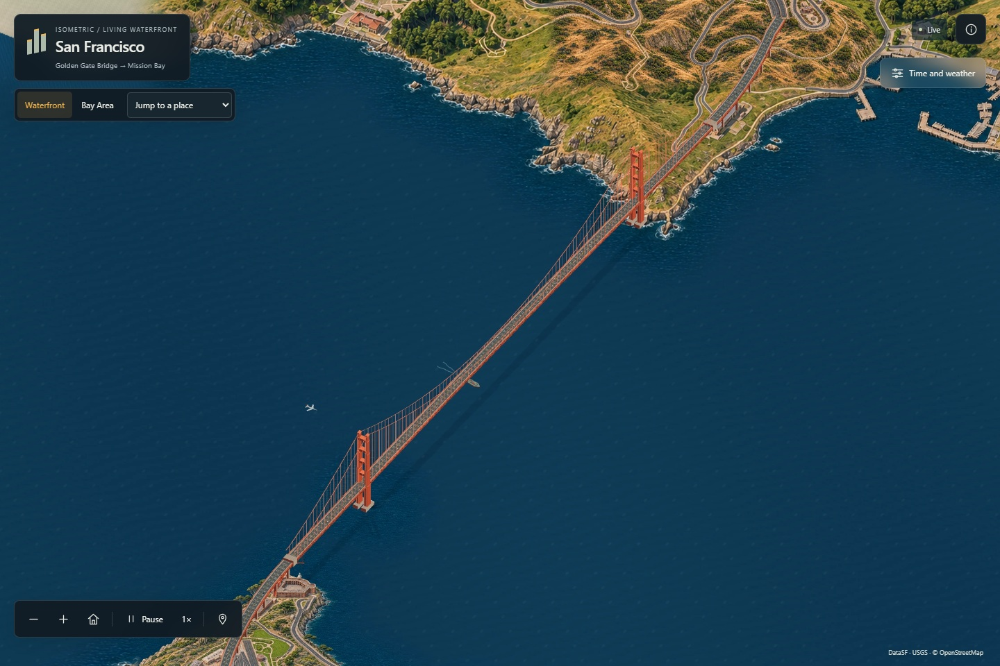

# Isometric San Francisco

A living illustrated map from the Golden Gate Bridge to Mission Bay, with a regional Bay Area atlas. Inspired by [Isometric NYC](https://cannoneyed.com/projects/isometric-nyc) and [Isometric Vancouver](https://vancouver.isoworld.xyz/).

**[Explore the live atlas](https://dilee-king.github.io/isometric-san-francisco/?v=0.4.0)** · [Actual demo video](docs/Waterfront-actual-demo-v0.4.mp4) · [Verification](docs/VERIFICATION-v0.4.md) · [Roadmap](ROADMAP.md)



## Explore

- **Waterfront:** pan continuously from the Golden Gate Bridge through Fort Point, Crissy Field, the Presidio, Marina Green, Fort Mason and Fisherman's Wharf, then along the Embarcadero to Mission Bay. The location selector has 22 jumps. The bridge jump frames both towers.
- **Bay Area:** switch to a regional terrain atlas with coastline, 26 towns/cities, major crossings and SFO, OAK and SJC. The amber outline marks the detailed waterfront. This view is regional context; detailed city coverage remains the published waterfront.
- **Time and weather:** Morning, Day, Dusk and Night; manual time or a five-minute cycle; Clear, Coastal Fog and Rain. Rain changes wet surfaces and reflections in addition to moving drops and impacts.
- **Traffic:** independently show cars, vessels and aircraft. The original world-space projection remains; the regional view enlarges transport for legibility. Pausing freezes all clocks, including across map-view switches.
- **Navigation:** drag and scroll, or use the map tools. Home returns to the default view; +/− zoom; Space plays or pauses when the map has focus. On mobile, use **Environment** to show the time/weather panel. Reduced motion starts paused. Without WebGL2, projected Canvas transport and dry lighting remain available; the unavailable effects are explained.

Actual captures: [Fort Mason](docs/screenshots/v0.4/fort-mason-clear.jpg) · [Crissy Field](docs/screenshots/v0.4/crissy-field-clear.jpg) · [Bridge in coastal fog](docs/screenshots/v0.4/bridge-coastal-fog.jpg) · [Marina in rain](docs/screenshots/v0.4/marina-rain-night.jpg) · [Offshore comparison](docs/screenshots/v0.4/offshore-comparison.jpg) · [Bay Area](docs/screenshots/v0.4/bay-overview.jpg).

## Run locally

Requires Node.js 24+. The map uses bundled assets; runtime does not need a map API key or an external basemap.

```powershell
npm ci
npm run dev
```

Development: `http://127.0.0.1:5186/`. Production preview:

```powershell
npm test
node tools/audit-atlas.mjs
npm run build
npm run preview
```

The production preview runs at `http://127.0.0.1:4186/`. GitHub Actions verifies the source/mask and asset checks and deploys GitHub Pages on updates to `main`.

## How it is made

The waterfront is a 12722 × 14408 pixel registered atlas. Twenty overlapping detail patches share the original 39° orthographic camera and 1.854545 pixels per metre. The ten new western plates use native 1536 × 1024 imagegen artwork, with four new plates for lower-density context. The bridge is drawn continuously with its towers, cables, deck and approach lanes in the same camera. Four western wet-night plates are authored edits; the remaining western variants use registered lights and wet materials. A continuous offshore water field replaces tile-specific tones away from the shore. The four appearances are packaged as WebP/DZI pyramids.

Source structures use [DataSF footprints](https://data.sf.gov/Geographic-Locations-and-Boundaries/Building-Footprints/ynuv-fyni), [USGS 2023 lidar](https://www.fisheries.noaa.gov/inport/item/73386), [USGS 3DEP elevation](https://elevation.nationalmap.gov/arcgis/rest/services/3DEPElevation/ImageServer) and [OpenStreetMap](https://www.openstreetmap.org/copyright). The bridge proportions follow the [district's published dimensions](https://www.goldengate.org/bridge/history-research/statistics-data/design-construction-stats/). The regional view uses [Natural Earth](https://www.naturalearthdata.com/) land/urban vectors, 3DEP terrain and schematic connectors. Both views share an EPSG:32610 origin and orientation.

The viewer requests visible tiles at the needed zoom; inactive appearances load on demand. Registered source masks drive approximate occlusion and atmosphere. React/OpenSeadragon provide the fixed-view map; a worker holds clocks and source-directed transport. The detailed corridor has 559 configured cars (including 48 on the bridge), six ferries, three cargo vessels and four occasional overflights. These are simulation instances, not observed traffic counts.

## Rebuild

Selected artwork and exact prompts are in [assets/golden-gate](assets/golden-gate/) and [assets/corridor](assets/corridor/). The [western source provenance](data/golden-gate/provenance.json), compressed local geometry and runtime manifests are checked in. To refresh the western source and package the atlas:

```powershell
python -m pip install -r tools/requirements-corridor.txt
python tools/golden_gate_inputs.py
python tools/golden_gate_source.py
python tools/render_golden_gate.py
python tools/package_golden_gate.py
node tools/audit-atlas.mjs
```

Raw network inputs stay in the ignored local cache. Skip acquisition and source derivation to repackage the checked-in geometry and selected artwork. The package rebuild does not require new artwork generation. The v1–v3 tiles remain available as release history.

## Scope

Coverage is the illustrated waterfront corridor plus a lower-detail regional overview, not full city- or nine-county street-level coverage. AI artwork can shift individual edges; lane offsets, facade details, bridge elevation, depth masks, lights and weather remain illustrative. Vehicle/ship routes are source-constrained where noted, without live trip feeds, physical weather, collision simulation or airport operations. See [coverage](data/coverage-plan.json) and [Acknowledgments](ACKNOWLEDGMENTS.md) for boundaries and licenses. Original code and documentation use the [MIT license](LICENSE); third-party data retain their respective notices.
