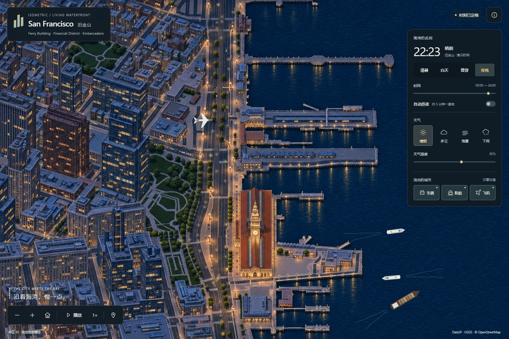

# Isometric San Francisco

旧金山市区与海湾沿岸的精细等轴测地图，计划加入车、船、飞机，以及可以独立组合的日夜与天气变化。

An illustrated isometric San Francisco, with a living waterfront, moving traffic, and changing light and weather.

**当前版本：可运行的连续滨水样区 v0.1。** 已包含车辆、两艘渡轮、一艘货船、偶发飞机飞越、昼夜精绘图块及晴／云／雾／雨。覆盖是三处地标周边的连续样区，尚未扩展至全市。



## 方向

沿用 [Isometric NYC](https://cannoneyed.com/projects/isometric-nyc) 与 [Isometric Vancouver](https://vancouver.isoworld.xyz/) 的公开制作思路：统一正交相机、真实城市结构参照、逐块绘制与接缝修整、多级图块浏览。浏览体验采用固定斜视角，支持平移和缩放。

首期目标是旧金山市区及北部、东部海湾沿岸。制作从 Ferry Building、Financial District 与 Embarcadero 的连续样区开始，再逐块向相邻市区、北部滨水、SoMa 与 Mission Bay 扩展。这个制作顺序是当前提案；完整边界由覆盖清单记录。

| 组成 | 目标行为 | 当前状态 |
| --- | --- | --- |
| 城市地图 | 细密建筑、街道、码头与岸线，连续缩放浏览 | 已交付连续样区 |
| 车辆 | 72 个车辆实例、22 条有向道路环线、推定车道偏移、转向与短暂停等 | 已实现示意交通；未做完整信号控制或车辆跟驰 |
| 船舶 | 两艘渡轮、一艘慢速货船、停靠等待与水面尾流 | 已实现；船体航线对源陆地／码头执行避障检查 |
| 飞机 | 与地图配准的偶发高空飞越和航行灯 | 已实现 |
| 日夜 | 配准昼夜图块混合、黄昏过渡、独立路灯与交通灯光 | 已实现；不计算物理太阳投影 |
| 天气 | 晴、多云、海雾、雨，独立于时间组合 | 已实现 WebGL2 效果和强度控制 |

首期不含 SFO 机场地面，飞机先表现为空中飞越。交通与天气是可控的演示动画；接入实时数据属于独立的后续工作。

## 技术路线

离线制作统一相机下的精绘图块，浏览器加载二维图块与动态叠加层。以纽约公开的 React / TypeScript / Vite / OpenSeadragon / DZI 流程为首版基础，参考温哥华的 WebGL 图层和 worker 交通组织。所有图层共用一套世界坐标到画面的变换。

本版使用源几何深度进行地面对象中心点遮挡，昼夜图块共享尺寸和视角。AI 精绘可能产生局部边缘差异，遮挡与窗灯是展示近似，不是最终画面的逐像素实测深度；细小对象可能在建筑边缘整体出现或隐藏。

完整方法见 [项目设计](docs/project-design.md)、[技术参照核对](docs/reference-audit.md) 和 [视觉规范](DESIGN.md)。

## 更新方式

- [路线图](ROADMAP.md)：每个阶段的交付物与完成条件。
- [覆盖计划](data/coverage-plan.json)：计划范围与已交付范围分别记录。
- [贡献说明](CONTRIBUTING.md)：修图、路线、效果和代码的提交规则。
- [致谢](ACKNOWLEDGMENTS.md)：与纽约、温哥华及相关开源项目的联系。
- [更新记录](CHANGELOG.md)：只记录已经交付的变化。

后续每个地图版本将绑定图块清单、来源记录、坐标配置和应用提交。大型图块及原始数据采用独立版本化存储，代码仓库保留清单与可复现步骤。

## 阅读与运行

需要 Node.js 24+。运行应用不需要账号、地图 API key 或外部地图服务。首次安装依赖需要网络：

```powershell
npm ci
npm run dev
```

打开终端显示的本地地址，默认 `http://127.0.0.1:5186/`。拖动平移、滚轮缩放；右侧控制时间、天气与交通，底部控制播放、交通速度和地名。自动昼夜约 5 分钟一循环。暂停会冻结交通、日夜与天气，仍可浏览地图。减少动态效果偏好下默认暂停。

```powershell
npm test
npm run build
npm run preview
```

生产预览默认 `http://127.0.0.1:4186/`。实际验证与限制见 [v0.1 验证记录](docs/VERIFICATION-v0.1.md)。

## 图块与数据复现

原始精绘 PNG、完整提示词、源派生几何与掩膜已保留。图像由内置 imagegen 生成；Python 只执行源几何栅格化、格式转换和确定性图块切分。准备依赖见 `tools/requirements.txt`。

```powershell
python -m pip install -r tools/requirements.txt
python tools/package_tiles.py
```

重新制作结构参照可运行 `python tools/prepare_source.py --source data/source/ferry.json`，再把生成的 `public/map/v1/scene.json` 保存到 `data/source/scene.json`，最后重新打包。模型生成不是确定性流程；这里保存的是选定原图与来源记录。

## License

本仓库原创代码与文档采用 [MIT](LICENSE)。第三方数据、图像和代码保留各自的许可及署名；参照项目的许可不自动覆盖它们引用的外部数据。详见 [资产规则](assets/README.md)。
