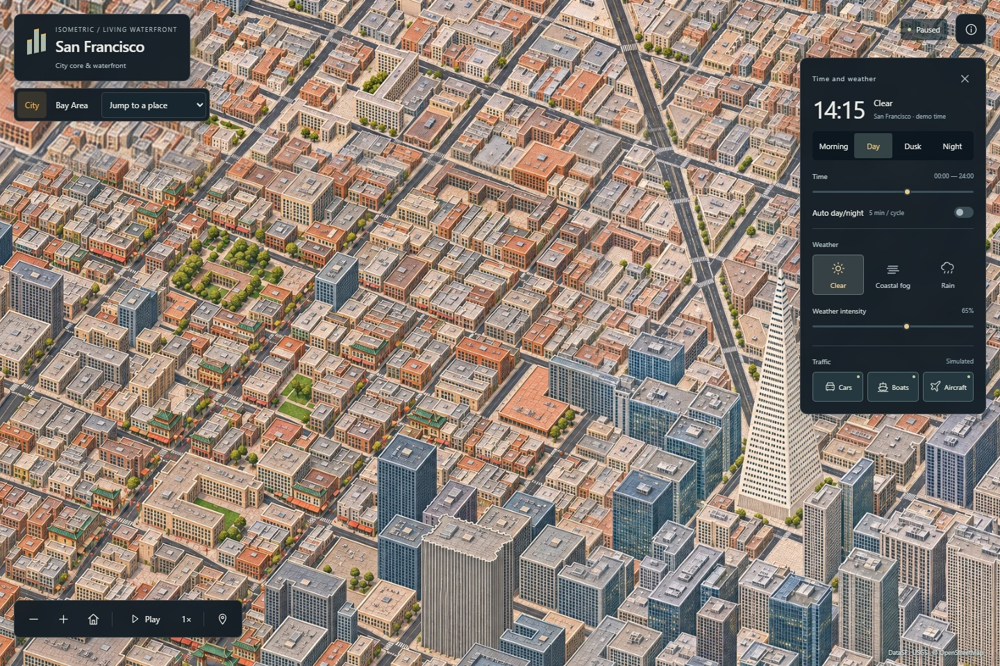

# Isometric San Francisco

A living illustrated map of San Francisco's city core and the waterfront from the Golden Gate Bridge to Mission Bay, with a regional Bay Area atlas. Inspired by [Isometric NYC](https://cannoneyed.com/projects/isometric-nyc) and [Isometric Vancouver](https://vancouver.isoworld.xyz/).

**[Explore the live atlas](https://dilee-king.github.io/isometric-san-francisco/?v=0.5.0)** · [Actual demo video](docs/City-core-actual-demo-v0.5.mp4) · [Verification](docs/VERIFICATION-v0.5.md) · [Roadmap](ROADMAP.md)



## Explore

- **City** connects Ferry Building, the Financial District, Chinatown, North Beach and Fisherman's Wharf, with Union Square to the south. Pan along the waterfront to the Golden Gate Bridge or Mission Bay. The location selector has 30 jumps. The bridge jump frames both towers.
- **Bay Area** switches to a regional terrain atlas with coastline, 26 towns/cities, major crossings and SFO, OAK and SJC. The amber outline marks the detailed city and waterfront coverage.
- **Time and weather:** Morning, Day, Dusk and Night; manual time or a five-minute cycle; Clear, Coastal Fog and Rain. Rain changes wet surfaces and reflections in addition to moving drops and impacts.
- **Traffic:** independently show cars, vessels and aircraft. The original world-space projection remains; the regional view enlarges transport for legibility. Pausing freezes all clocks, including across map-view switches.
- **Navigation:** drag and scroll, or use the map tools. Home returns to the default view; +/− zoom; Space plays or pauses when the map has focus. On mobile, use **Environment** to show the time/weather panel. Reduced motion starts paused. Without WebGL2, projected Canvas transport and dry lighting remain available; the unavailable effects are explained.

Actual captures include [Financial District](docs/screenshots/v0.5/financial-district-clear.jpg), [North Beach](docs/screenshots/v0.5/north-beach-clear.jpg), [Union Square in rain at night](docs/screenshots/v0.5/union-square-rain-night.jpg), [Golden Gate Bridge](docs/screenshots/v0.5/bridge-clear.jpg) and [Bay Area](docs/screenshots/v0.5/bay-overview.jpg). The earlier [offshore comparison](docs/screenshots/v0.4/offshore-comparison.jpg) records the water-field correction retained in this release.

## Run locally

Requires Node.js 24+. The map uses bundled assets; runtime does not need a map API key or an external basemap.

```powershell
npm ci
npm run dev
```

Development: `http://127.0.0.1:5186/`. Production preview:

```powershell
npm test
node tools/audit-atlas.mjs
node --experimental-strip-types tools/audit-city-core.mjs
npm run build
npm run preview
```

The production preview runs at `http://127.0.0.1:4186/`. GitHub Actions verifies the source/mask and asset checks and deploys GitHub Pages on updates to `main`.

## How it is made

The city and waterfront form a 12722 × 14408 pixel registered atlas. Twenty-seven overlapping native detail patches share the original 39° orthographic camera and 1.854545 pixels per metre, alongside ten lower-density context plates. The seven new city plates use native 1536 × 1024 imagegen artwork. The bridge is drawn continuously with its towers, cables, deck and approach lanes in the same camera. Selected city and western wet-night plates are authored edits. Other appearances use registered lights and wet materials. A continuous offshore water field supplies the sea away from the shore.

Source structures use [DataSF footprints](https://data.sf.gov/Geographic-Locations-and-Boundaries/Building-Footprints/ynuv-fyni), [USGS 2023 lidar](https://www.fisheries.noaa.gov/inport/item/73386), [USGS 3DEP elevation](https://elevation.nationalmap.gov/arcgis/rest/services/3DEPElevation/ImageServer) and [OpenStreetMap](https://www.openstreetmap.org/copyright). The bridge proportions follow the [district's published dimensions](https://www.goldengate.org/bridge/history-research/statistics-data/design-construction-stats/). The regional view uses [Natural Earth](https://www.naturalearthdata.com/) land/urban vectors, 3DEP terrain and schematic connectors. Both views share an EPSG:32610 origin and orientation.

The four WebP pyramids use named regional directories and one shared low-zoom package. OpenSeadragon resolves each visible tile to its region and requests the required appearance on demand. Image coordinates, source depth, masks and the simulation worker remain shared across districts. React/OpenSeadragon provide the fixed-view map. The detailed view has 699 configured cars, including 48 on the bridge, six ferries, three cargo vessels and five occasional overflights. These counts describe simulation instances.

## Rebuild

Selected artwork and exact prompts are in [assets/city-core](assets/city-core/), [assets/golden-gate](assets/golden-gate/) and [assets/corridor](assets/corridor/). The [city source provenance](data/city-core/provenance.json), [western source provenance](data/golden-gate/provenance.json), compressed geometry and runtime manifests are checked in. To package v0.5 from retained geometry and artwork:

```powershell
python -m pip install -r tools/requirements-corridor.txt
npm run tiles
node --experimental-strip-types tools/audit-city-core.mjs
```

Raw network inputs stay in the ignored local cache. A full regional rebuild fetches missing Natural Earth and 3DEP context. `python tools/city_core_source.py --refresh` rederives the inland snapshot from the bounded source inputs. To rebuild just the detailed view, render the references and run `python tools/package_city_core.py prepare`, then `tiles` and `manifest` with the checked-in regional view. The v1–v4 tiles remain available as release history.

## Scope

Detailed coverage follows the published city-core and waterfront patches. The Bay Area view supplies broader geographic context. AI artwork can shift individual edges, and lane offsets, facade details, bridge elevation, depth masks, lights and weather remain illustrative. Transport follows configured source-directed routes. See [coverage](data/coverage-plan.json) and [Acknowledgments](ACKNOWLEDGMENTS.md) for boundaries and licenses. Original code and documentation use the [MIT license](LICENSE). Third-party data retain their respective notices.
